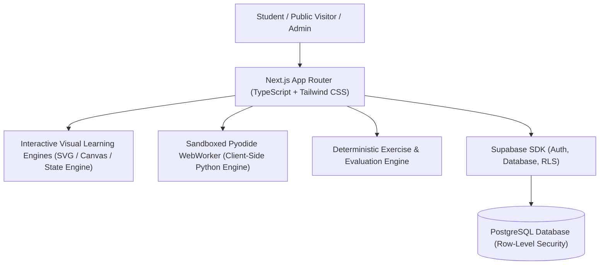

# ALGO LAB — Architecture Specification

## 1. System Overview
ALGO LAB is built on Next.js 14/15 with the App Router, completely statically exportable or server-rendered on Vercel, integrating with a PostgreSQL database via Supabase.



## 2. Security Boundaries & Zero AI Execution
- **Zero AI Runtime Dependency:** All course explanations, algorithmic traces, hints, unit tests, and test suites are statically prepared and verified against the Tunisian curriculum.
- **Python Execution:** Runs exclusively in an isolated browser `WebWorker` using Pyodide:
  - Max runtime: 5,000 ms (timeout prevention for infinite loops).
  - No access to DOM, localStorage, browser cookies, or application tokens.
  - Standard I/O virtualized through synthetic `stdin` buffers and `stdout` collectors.
- **Data Protection:** Supabase Row Level Security (RLS) ensures:
  - Public anonymous users can read published educational content.
  - Logged-in students can only read and write their own submissions, progress records, and bookmarks.
  - Administrative endpoints and mutations require verified `admin` role in JWT / user_roles table.

## 3. Directory Layout
```
d:\algo tun\
├── content/               # Verified curriculum JSON/TS definitions & model solutions
│   ├── modules.ts
│   ├── lessons.ts
│   ├── exercises.ts
│   └── exams.ts
├── docs/                  # Architectural and curriculum documentation
├── public/                # Static assets, fonts, icons, Pyodide worker scripts
├── src/
│   ├── app/               # Next.js App Router pages
│   │   ├── (public)/      # Public pages: /, /courses, /algorithmique, /python, etc.
│   │   ├── (auth)/        # /login, /register
│   │   ├── dashboard/     # Student personal progress dashboard
│   │   ├── admin/         # Content management and publishing dashboard
│   │   ├── playground/    # Sandboxed Python coding environment
│   │   └── visualizer/    # Algorithm visualizer suite
│   ├── components/        # Reusable UI components
│   │   ├── layout/        # Navbar, Footer, Breadcrumbs, Sidebar
│   │   ├── ui/            # Buttons, Badges, Tabs, Modals, Callouts
│   │   ├── visualizers/   # Flowchart, Array, Sorting, Recursion
│   │   ├── exercises/     # QCM, Code Completion, Trace, Diff
│   │   └── playground/    # Code editor, terminal console, test runner
│   ├── lib/               # Utilities, Supabase client, Python worker bridge
│   └── types/             # TypeScript types and interfaces
└── supabase/
    └── migrations/        # SQL DDL & RLS security policies
```
