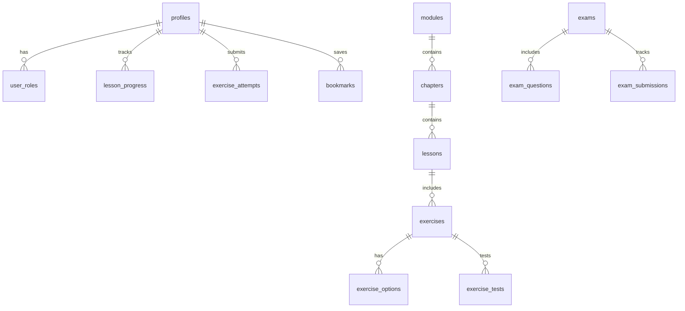

# ALGO LAB — PostgreSQL & Supabase Database Architecture

## 1. Schema Entities



## 2. Table Definitions & DDL

```sql
-- Enable UUID extension
CREATE EXTENSION IF NOT EXISTS "uuid-ossp";

-- 1. Profiles & Roles
CREATE TABLE IF NOT EXISTS public.profiles (
    id UUID PRIMARY KEY REFERENCES auth.users(id) ON DELETE CASCADE,
    email TEXT NOT NULL,
    full_name TEXT,
    avatar_url TEXT,
    created_at TIMESTAMPTZ DEFAULT NOW(),
    updated_at TIMESTAMPTZ DEFAULT NOW()
);

CREATE TYPE user_role_enum AS ENUM ('student', 'teacher', 'admin', 'superadmin');

CREATE TABLE IF NOT EXISTS public.user_roles (
    id UUID PRIMARY KEY DEFAULT uuid_generate_v4(),
    user_id UUID NOT NULL REFERENCES public.profiles(id) ON DELETE CASCADE,
    role user_role_enum NOT NULL DEFAULT 'student',
    created_at TIMESTAMPTZ DEFAULT NOW(),
    UNIQUE(user_id, role)
);

-- 2. Curriculum Management
CREATE TYPE publication_status AS ENUM ('draft', 'review', 'approved', 'published');

CREATE TABLE IF NOT EXISTS public.modules (
    id UUID PRIMARY KEY DEFAULT uuid_generate_v4(),
    slug TEXT UNIQUE NOT NULL,
    title TEXT NOT NULL,
    description TEXT,
    order_index INT NOT NULL DEFAULT 0,
    status publication_status NOT NULL DEFAULT 'draft',
    created_at TIMESTAMPTZ DEFAULT NOW()
);

CREATE TABLE IF NOT EXISTS public.chapters (
    id UUID PRIMARY KEY DEFAULT uuid_generate_v4(),
    module_id UUID NOT NULL REFERENCES public.modules(id) ON DELETE CASCADE,
    slug TEXT UNIQUE NOT NULL,
    title TEXT NOT NULL,
    description TEXT,
    order_index INT NOT NULL DEFAULT 0,
    status publication_status NOT NULL DEFAULT 'draft',
    created_at TIMESTAMPTZ DEFAULT NOW()
);

CREATE TABLE IF NOT EXISTS public.lessons (
    id UUID PRIMARY KEY DEFAULT uuid_generate_v4(),
    chapter_id UUID NOT NULL REFERENCES public.chapters(id) ON DELETE CASCADE,
    slug TEXT UNIQUE NOT NULL,
    title TEXT NOT NULL,
    learning_objectives TEXT[],
    prerequisites TEXT[],
    french_definition TEXT NOT NULL,
    derja_explanation TEXT NOT NULL,
    algo_syntax TEXT,
    python_syntax TEXT,
    examples JSONB DEFAULT '[]'::jsonb,
    source_reference TEXT,
    verification_status TEXT DEFAULT 'VERIFIED_OFFICIAL',
    status publication_status NOT NULL DEFAULT 'draft',
    order_index INT NOT NULL DEFAULT 0,
    created_at TIMESTAMPTZ DEFAULT NOW(),
    updated_at TIMESTAMPTZ DEFAULT NOW()
);

-- 3. Exercises & Tests
CREATE TYPE exercise_type_enum AS ENUM (
    'qcm',
    'algo_completion',
    'function_completion',
    'debugging',
    'trace_execution',
    'conversion',
    'bac_exam_item'
);

CREATE TYPE difficulty_level AS ENUM ('debutant', 'facile', 'moyen', 'difficile', 'niveau_bac');

CREATE TABLE IF NOT EXISTS public.exercises (
    id UUID PRIMARY KEY DEFAULT uuid_generate_v4(),
    lesson_id UUID REFERENCES public.lessons(id) ON DELETE SET NULL,
    slug TEXT UNIQUE NOT NULL,
    title TEXT NOT NULL,
    type exercise_type_enum NOT NULL,
    difficulty difficulty_level NOT NULL DEFAULT 'facile',
    statement TEXT NOT NULL,
    derja_tip TEXT,
    starter_code TEXT,
    expected_answer TEXT,
    hints JSONB DEFAULT '[]'::jsonb,
    test_cases JSONB DEFAULT '[]'::jsonb,
    solution_explanation TEXT NOT NULL,
    status publication_status NOT NULL DEFAULT 'draft',
    created_at TIMESTAMPTZ DEFAULT NOW()
);

-- 4. Student Tracking & Progress
CREATE TABLE IF NOT EXISTS public.lesson_progress (
    id UUID PRIMARY KEY DEFAULT uuid_generate_v4(),
    user_id UUID NOT NULL REFERENCES public.profiles(id) ON DELETE CASCADE,
    lesson_id UUID NOT NULL REFERENCES public.lessons(id) ON DELETE CASCADE,
    is_completed BOOLEAN NOT NULL DEFAULT FALSE,
    last_visited_at TIMESTAMPTZ DEFAULT NOW(),
    UNIQUE(user_id, lesson_id)
);

CREATE TABLE IF NOT EXISTS public.exercise_attempts (
    id UUID PRIMARY KEY DEFAULT uuid_generate_v4(),
    user_id UUID NOT NULL REFERENCES public.profiles(id) ON DELETE CASCADE,
    exercise_id UUID NOT NULL REFERENCES public.exercises(id) ON DELETE CASCADE,
    submitted_code TEXT,
    is_correct BOOLEAN NOT NULL,
    score INT NOT NULL DEFAULT 0,
    created_at TIMESTAMPTZ DEFAULT NOW()
);

CREATE TABLE IF NOT EXISTS public.bookmarks (
    id UUID PRIMARY KEY DEFAULT uuid_generate_v4(),
    user_id UUID NOT NULL REFERENCES public.profiles(id) ON DELETE CASCADE,
    lesson_id UUID REFERENCES public.lessons(id) ON DELETE CASCADE,
    created_at TIMESTAMPTZ DEFAULT NOW(),
    UNIQUE(user_id, lesson_id)
);

-- 5. Row-Level Security (RLS)
ALTER TABLE public.profiles ENABLE ROW LEVEL SECURITY;
ALTER TABLE public.user_roles ENABLE ROW LEVEL SECURITY;
ALTER TABLE public.modules ENABLE ROW LEVEL SECURITY;
ALTER TABLE public.chapters ENABLE ROW LEVEL SECURITY;
ALTER TABLE public.lessons ENABLE ROW LEVEL SECURITY;
ALTER TABLE public.exercises ENABLE ROW LEVEL SECURITY;
ALTER TABLE public.lesson_progress ENABLE ROW LEVEL SECURITY;
ALTER TABLE public.exercise_attempts ENABLE ROW LEVEL SECURITY;
ALTER TABLE public.bookmarks ENABLE ROW LEVEL SECURITY;

-- Public can read published content
CREATE POLICY "Public read published modules" ON public.modules FOR SELECT USING (status = 'published');
CREATE POLICY "Public read published chapters" ON public.chapters FOR SELECT USING (status = 'published');
CREATE POLICY "Public read published lessons" ON public.lessons FOR SELECT USING (status = 'published');
CREATE POLICY "Public read published exercises" ON public.exercises FOR SELECT USING (status = 'published');

-- Students can read & update their own records
CREATE POLICY "Students manage own progress" ON public.lesson_progress FOR ALL USING (auth.uid() = user_id);
CREATE POLICY "Students manage own attempts" ON public.exercise_attempts FOR ALL USING (auth.uid() = user_id);
CREATE POLICY "Students manage own bookmarks" ON public.bookmarks FOR ALL USING (auth.uid() = user_id);
CREATE POLICY "Users read/update own profile" ON public.profiles FOR ALL USING (auth.uid() = id);
```
